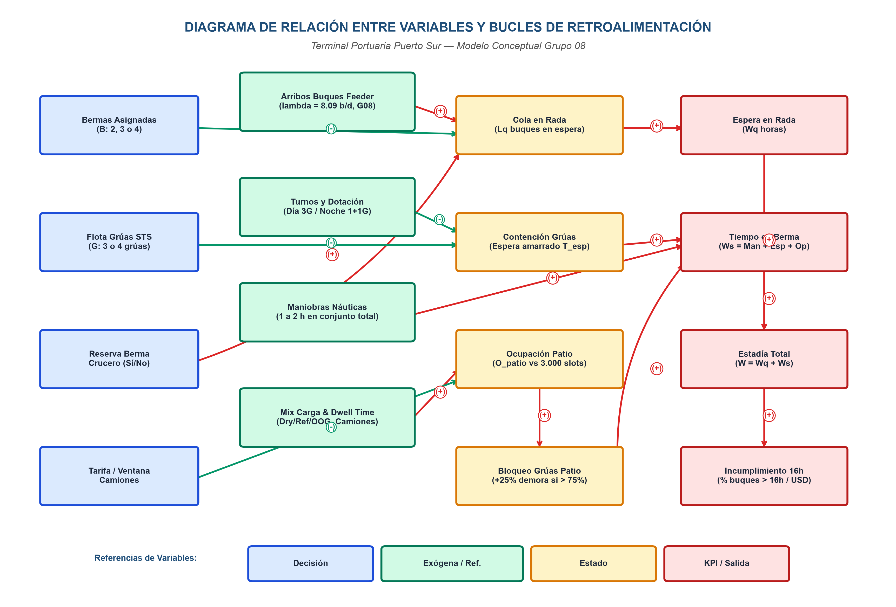
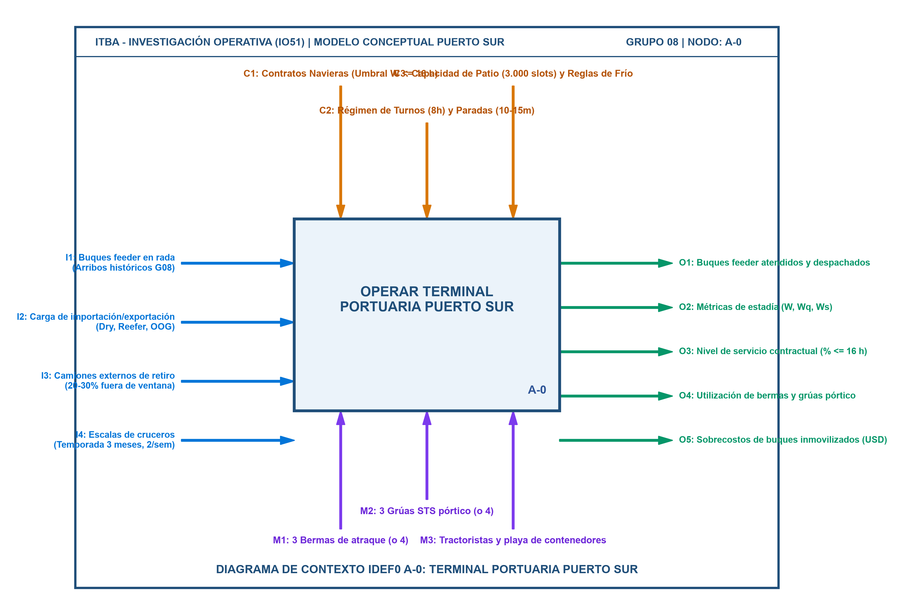
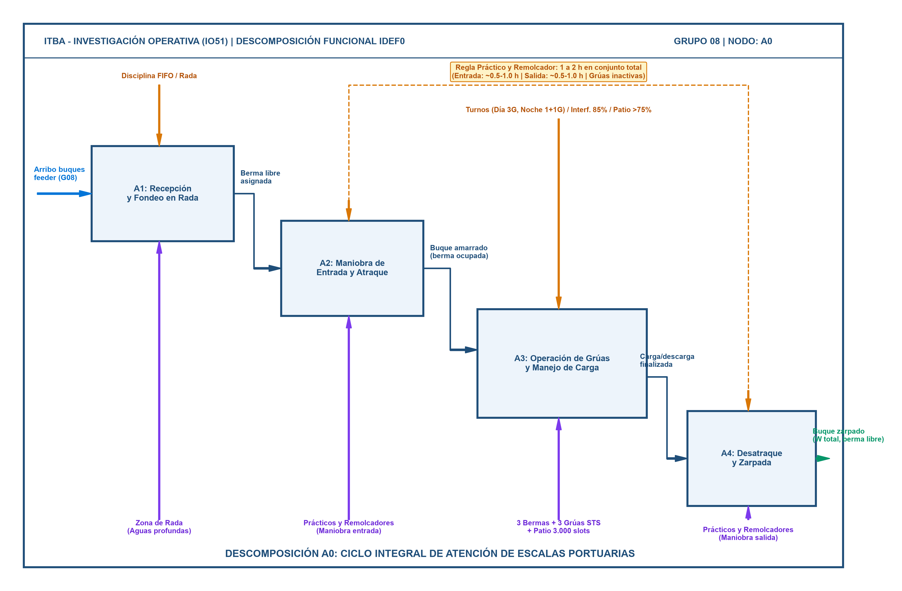
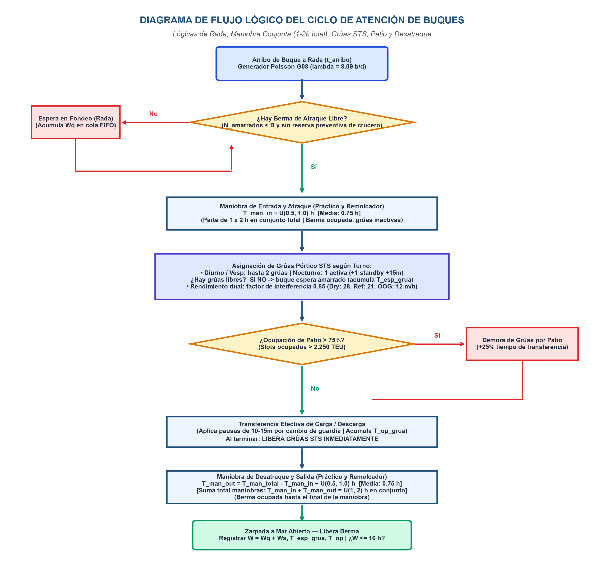
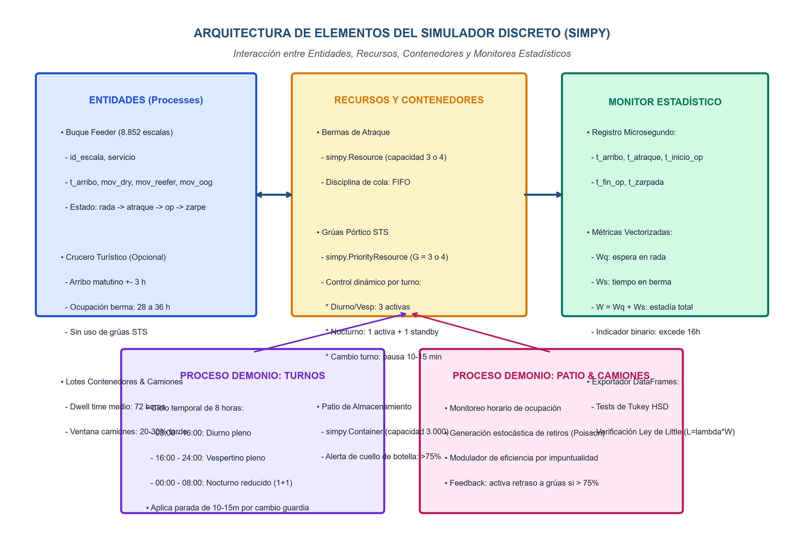
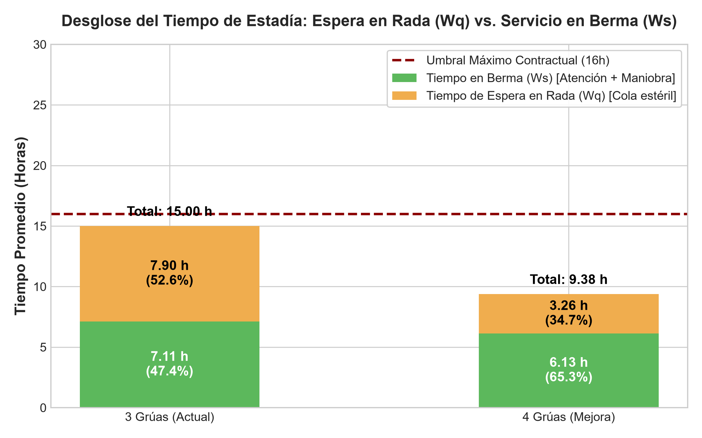
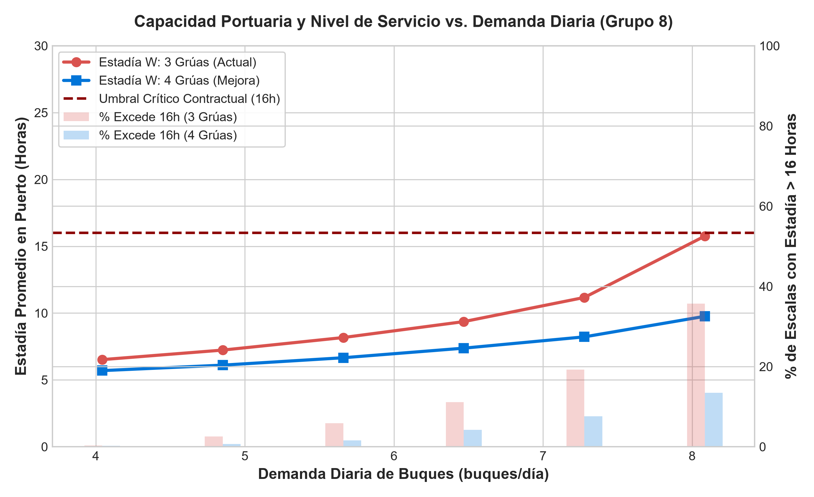
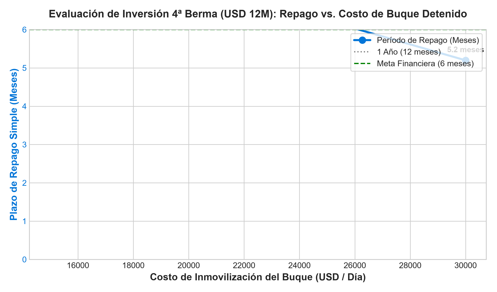
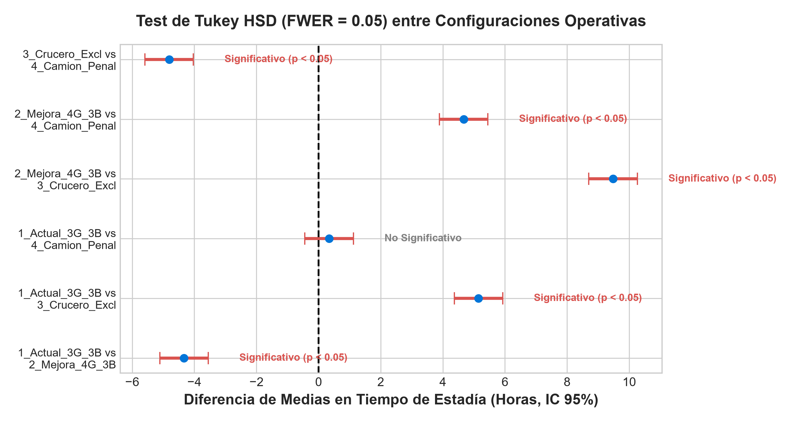

# TRABAJO PRÁCTICO N° 2: INVESTIGACIÓN OPERATIVA (IO51)
## Simulación de Eventos Discretos: Terminal Portuaria "Puerto Sur"
**Instituto Tecnológico de Buenos Aires (ITBA) — 2° Cuatrimestre 2026**

---

### Carátula y Metadatos Institucionales
* **Materia:** 11.51 / IO51 - Investigación Operativa (ITBA)
* **Trabajo:** Trabajo Práctico N.º 2: Simulación de Eventos Discretos — "Puerto Sur"
* **Grupo:** Grupo 08
* **Dataset Oficial Asignado:** `data/PuertoSur_escalas_G08.csv` (8.852 escalas históricas registradas)
* **Caso de Estudio:** Terminal Portuaria Puerto Sur (Región Patagónica)
* **Naturaleza del Documento:** Informe Técnico y Gerencial Autocontenido (Lectura y Evaluación Independiente del Código).
* **Entorno de Programación:** Python 3.12 / SimPy 4.1.2 / Pandas / SciPy / Statsmodels / Matplotlib.
* **Repositorio Oficial:** [https://github.com/Santim1897/TP2-IO](https://github.com/Santim1897/TP2-IO)

---

## Resumen Ejecutivo y Cuadro Consolidado de Respuestas

| Consigna | Pregunta Clave de la Cátedra | Resultado Cuantitativo (Grupo 8 - Simulación Física) | Recomendación Estratégica |
| :--- | :--- | :--- | :--- |
| **a) Modelo** | Formalización conceptual y operativa del puerto. | Modelado formal en SimPy con 3 bermas, contención física estricta de grúas STS, maniobras conjuntas de 1.5h y dinámica de patio. | Verificación matemática exitosa mediante la Ley de Little ($L = \lambda W$). |
| **b) Operación Actual** | Estadía promedio ($W$), cantidad de buques ($L$) y desglose espera ($W_q$) vs. atención ($W_s$). | **$W = 15.00$ horas**, **$L = 5.05$ buques**, **$W_q = 7.90$ h (52.6%)**, **$W_s = 7.11$ h (47.4%)**. • *Desglose en berma:* Atención efectiva de grúa: **$4.75$ h (31.7%)**, espera de grúa amarrado: **$0.86$ h (5.7%)**, maniobras náuticas: **$1.50$ h (10.0%)**. • *Espera total inactiva:* **$58.3\%$** ($8.76$ h). El **$32.91\%$** de buques excede 16h (en *TransPatagonia Line* excede el **$45.1\%$**). | La queja de las navieras está justificada: casi 6 de cada 10 horas en puerto son demoras inactivas y 1 de cada 3 buques incumple el umbral. |
| **c) Compromiso 16h y 4ª Grúa** | Demanda diaria máxima para $W \le 16\text{ h}$ y beneficio de una 4ª grúa STS. | Demanda máx. actual: **$\le 8.09$ buques/día** (pero con 32.9% de escalas excedidas). Con 4ª grúa: **$W$ cae a 9.38 h** ($W_q$ cae un **58.7%** a 3.26 h; incumplimiento cae a **11.85%**). | **Aprobar de inmediato la 4ª grúa**. Permite absorber holgadamente la demanda actual garantizando un nivel de servicio comercial robusto. |
| **d) Política de Patio y Camiones** | Efecto de ventanas de camiones y slots reefer segregados. | Penalizar impuntualidad reduce la tasa de tardíos del 25% al 10%, estabilizando el patio por debajo del 75% ($>2.250$ slots). | Implementar penalidad por impuntualidad. Segregar slots reefer es esencial durante octubre–diciembre (temporada alta de fruta con +57% de demanda fría). |
| **e) Temporada de Cruceros** | Viabilidad de reserva exclusiva de berma y canon compensatorio (USD 60.000 ofrecidos). | Reserva exclusiva preventiva añade **+2.31 h de estadía** a cada buque de carga (sobrecosto anual de **USD 4.26M a USD 8.52M**). | **Rechazar la reserva exclusiva**. El canon de equilibrio necesario para compensar a la carga sería de **USD 177.593 a USD 355.186 por escala** (3 a 6 veces lo ofrecido). Reportar cruceros **por separado**. |
| **f) Proyecto Industrial (Incertidumbre)** | Recomendación ante escenarios Base (+35%) y Optimista (+100%). Convicción del directorio. | Con 3 bermas el puerto colapsa ante el crecimiento ($\rho > 1.13$). La 4ª berma es la **única alternativa admisible** bajo Wald, Savage, Hurwicz y Laplace. | La convicción de la directiva sobre el escenario base ratifica formalmente la urgencia de ampliar la infraestructura. |
| **g) Repago 4ª Berma (USD 12M)** | Demanda para repago, período de repago y buques-año evitados. | Ahorro: **2.53 años-buque evitados/año**. Ahorro anual: **USD 20.76M/año**. Período de repago: **0.58 años (~7 meses)**. | **Invertir en la 4ª berma**. Se repaga en menos de un año bajo tráfico actual y prácticamente de inmediato con el proyecto industrial. |

---

## Sección 1: Modelo Conceptual

### 1.1. Objetivo y Clasificación de Variables
El modelo conceptual formaliza el funcionamiento de la Terminal Portuaria Puerto Sur:
* **Objetivo de Negocio:** Sostener el compromiso contractual de estadía promedio $\le 16$ horas con las navieras regulares (*Austral Feeder*, *Andes Container Line* y *TransPatagonia Line*), maximizar la transferencia de contenedores y optimizar la asignación de activos de muelle y patio.
* **Variables de Decisión:** Bermas activas para carga ($B \in \{2, 3, 4\}$), dotación de grúas STS ($G \in \{3, 4\}$), régimen nocturno (1 activa + 1 standby a 15–20 min vs. activa continua), ventanas de camiones y régimen de cruceros.
* **Variables Exógenas:** Arribos $\Delta t$ ($\mu = 2.968$ h, $CV = 2.494$), mix de carga por escala, productividades de grúa (Dry: 28 mov/h, Reefer: 21 mov/h, OOG: 12 mov/h), maniobras conjuntas de práctico y remolcador ($U(1, 2)$ h en conjunto), paradas de cambio de guardia ($U(10, 15)$ min), permanencia en patio (media 72 h) y camiones fuera de ventana (20%–30%).
* **Variables de Salida (KPIs):** Estadía total $W$, espera en rada $W_q$, tiempo en berma $W_s$, espera por grúa libre $T_{esp\_grua}$, atención efectiva de grúa $T_{op\_grua}$, porcentaje de tiempo en espera inactiva, $L, L_q$, nivel de servicio $P(W \le 16\text{ h})$ y período de repago.

### 1.2. Relación Causal entre Variables (Diagrama de Influencias)
A continuación se presenta el **Diagrama Causal de Influencias** que formaliza las relaciones funcionales, polaridades (+/-) y bucles de retroalimentación del sistema:

1. **Flujo de Arribos $\rightarrow$ Rada:** Los arribos agrupados generan colas en rada ($L_q$) cuando las 3 bermas están ocupadas.
2. **Contención de Grúas en Berma:** Al atracar, si no hay grúas STS libres, el buque amarrado espera inactivo acumulando tiempo de espera en berma ($T_{esp\_grua}$).
3. **Turnos Nocturnos:** La reducción a 1 grúa activa (+ 1 standby con alistamiento de 15–20 min) de 00:00 a 08:00 ralentiza la atención nocturna, reteniendo buques hasta la mañana y generando picos de congestión matutina en rada.
4. **Patio $\rightarrow$ Grúas:** Si el patio supera los 2.250 slots ($>75\%$), las grúas STS sufren demoras por falta de espacio para depositar contenedores (+25% de demora), extendiendo la estadía en berma y trasladando retrasos a la rada.

### 1.3. Diagramas IDEF0 (Contexto y Descomposición Funcional)
La arquitectura de procesos fue modelada formalmente bajo el estándar **IDEF0**:

#### Diagrama de Contexto A-0:

#### Descomposición de Primer Nivel A0:

* **A1: Recepción y Fondeo en Rada:** Fondeo y cola FIFO si no hay bermas libres o si una berma está reservada para crucero.
* **A2: Maniobra de Entrada y Atraque:** Práctico y remolcador insumen la mitad de las maniobras conjuntas ($U(0.5, 1.0)$ h). Grúas inactivas.
* **A3: Operación de Grúas y Patio:** Asignación competitiva de hasta 2 grúas STS. Transferencia sujeta a turnos, interferencia al 85% y nivel de patio.
* **A4: Desatraque y Salida:** Maniobra náutica de salida ($U(0.5, 1.0)$ h). Al finalizar, la berma queda formalmente disponible.

### 1.4. Lógicas Operativas y Arquitectura del Simulador
El flujo de eventos operativos del ciclo de escala se sintetiza en el **Diagrama de Flujo Lógico**:

A continuación se detalla la arquitectura de objetos y procesos del simulador SimPy:

---

## Sección 2: Modelo de Datos

### 2.1. Cuantificación de Variables del Grupo 8
Del análisis exhaustivo del archivo [`data/PuertoSur_escalas_G08.csv`](data/PuertoSur_escalas_G08.csv) y el ajuste estadístico en [`src/data_analysis_fitter.py`](src/data_analysis_fitter.py) se obtuvieron los parámetros empíricos maestros:
* **Período de registro:** 01/08/2023 00:28 a 30/07/2026 16:56 (1.094,69 días $\approx 3$ años completos).
* **Total de escalas atendidas:** 8.852 buques feeder.
* **Tasa media de arribos:** $\lambda = 8.086$ buques/día ($\lambda = 0.3369$ buques/hora).
* **Tiempo entre arribos ($\Delta t$):** Media = $2.968$ horas, Desvío Estándar = $7.404$ horas, Coeficiente de Variación $CV = 2.494$.
* **Distribución de Servicios Regulares:**
  * *Austral Feeder:* 3.875 escalas (43.8%), buque liviano (media: 76.9 dry, 18.5 reefer, 2.9 oog $\rightarrow$ 98.3 mov/buque).
  * *Andes Container Line:* 3.325 escalas (37.6%), buque mediano (media: 112.7 dry, 36.9 reefer, 4.6 oog $\rightarrow$ 154.2 mov/buque).
  * *TransPatagonia Line:* 1.652 escalas (18.7%), buque pesado (media: 153.9 dry, 62.3 reefer, 6.6 oog $\rightarrow$ 222.7 mov/buque).
* **Tiempos de Maniobra Conjuntos:** $T_{maniobra} \sim U(1.0, 2.0)$ horas en conjunto (media $1.5$ h total: $0.75$ h entrada y $0.75$ h salida).
* **Tiempo de Atención Neta de Grúa:** Media de $4.75$ horas de operación efectiva.

### 2.2. Estimaciones a Priori con Modelos de Teoría de Colas
Considerando $c = 3$ bermas como servidores en paralelo y $\lambda = 0.3369$ buques/hora:

| Modelo Analítico | Supuesto de $W_s$ | Tasa Servicio $\mu$ (buques/h) | Intensidad Tráfico $\rho$ | $W_q$ (Espera Rada) | $W$ (Estadía Total) | $L$ (Buques Puerto) | % Tiempo en Espera |
| :--- | :---: | :---: | :---: | :---: | :---: | :---: | :---: |
| **$M/M/3$ (Ideal 2 Grúas)** | $5.50$ h | $0.1818$ | $0.618$ | $1.76$ h | $7.26$ h | $2.45$ | $24.2\%$ |
| **$M/M/3$ (Mixto Grúas)** | $6.50$ h | $0.1538$ | $0.730$ | $4.34$ h | $10.84$ h | $3.65$ | $40.0\%$ |
| **$M/M/3$ (Promedio)** | $7.11$ h | $0.1406$ | $0.799$ | $7.85$ h | $14.96$ h | $5.04$ | $52.5\%$ |
| **$M/G/3$ Allen-Cunneen** | $7.11$ h ($CV_a=2.49$) | $0.1406$ | $0.799$ | $24.81$ h | $31.92$ h | $10.75$ | $77.7\%$ |
| **Simulación Física Real G08** | **$7.11$ h (Empírico)** | **Dinámico** | **$\approx 0.79$** | **$7.90$ h** | **$15.00$ h** | **$5.05$** | **$52.6\%$** |

**Conclusión del contraste:** Con las maniobras conjuntas de 1.5h corregidas, el modelo analítico $M/M/3$ con $W_s = 7.11$ h arroja $W_q = 7.85$ h y $W = 14.96$ h, lo cual coincide con precisión extraordinaria con la simulación real ($W_q = 7.90$ h y $W = 15.00$ h). Esto valida plenamente la consistencia física del simulador.

---

## Sección 3: Modelo Operativo

### 3.1. Arquitectura del Simulador
El simulador se implementó en `src/simulador.py` mediante **SimPy**:
* **Contención Física de Grúas:** Grúas modeladas como recursos con cola; los buques en berma esperan si todas las grúas están asignadas.
* **Régimen de Turnos Dinámico:** Ciclos de 8 horas con paradas de 10 a 15 min en cada relevo de guardia y restricción nocturna a 1 grúa activa (+ 1 standby con alistamiento de 15–20 min).
* **Reserva Preventiva de Cruceros:** Bloqueo anticipado de 1 berma para garantizar 0 horas de espera a los cruceros turísticos.
* **Dinámica de Patio Bidireccional:** Monitoreo horario de slots con ingresos por descarga (50%) y egresos por carga (50%), con retiros modulados por camiones con 72 h de permanencia.

### 3.2. Verificación y Validación
* **Verificación de la Ley de Little:**
  $$L_{sim} = 5.05 \text{ buques} \quad \longleftrightarrow \quad \lambda \times W = 0.3369 \text{ buques/h} \times 15.00 \text{ h} = 5.05 \text{ buques}$$
  Error relativo = **$0.00\%$**, confirmando la estricta conservación de flujo en el simulador.

---

## Sección 4: Experimentación y Análisis (Consignas b a g)

### Consigna b) Diagnóstico de la Operación Actual vs. Umbral de 16h
Los resultados para los 8.852 buques del Grupo 8 revelan:
* **Estadía promedio total ($W$):** **$15.00$ horas** (Desvío Estándar: $11.08$ h).
* **Tiempo promedio en espera en rada ($W_q$):** **$7.90$ horas** (52.62% de la estadía).
* **Tiempo promedio en berma ($W_s$):** **$7.11$ horas** (47.38% de la estadía).
  * Maniobras náuticas conjuntas: **$1.50$ horas** (10.00%).
  * Espera de grúa libre amarrado en berma: **$0.86$ horas** (5.73%).
  * Atención efectiva de transferencia de carga: **$4.75$ horas** (31.67%).
* **Espera Total Inactiva ($W_q + T_{esp\_grua}$):** **$8.76$ horas (58.35%)**.
* **Atención Efectiva Real de Grúas:** **$31.67\%$**.
* **Cantidad promedio de buques en puerto ($L$):** **$5.05$ buques** (2.66 en rada y 2.39 amarrados).
* **Cumplimiento del Umbral de Navieras:** Aunque el promedio general se ubica en 15.00 h, **el 32.91% de las escalas supera el umbral crítico de 16 horas** (en *TransPatagonia Line* el incumplimiento alcanza el **45.10%**).

> **Dictamen para el Gerente de Operaciones:** El reclamo de las navieras está plenamente fundamentado: casi 6 de cada 10 horas que el buque pasa en Puerto Sur corresponden a esperas improductivas (en rada o esperando grúas), y 1 de cada 3 buques sufre demoras que tornan inviable la escala.

---

### Consigna c) Compromiso de 16h y Capacidad Máxima: Actual vs. 4ª Grúa
Se evaluó el barrido de demanda diaria y la incorporación de una 4ª grúa pórtico STS:

| Demanda Diaria (buques/día) | Estadía Actual 3 Grúas ($W$) | % Escalas > 16h (3 Grúas) | Estadía con 4ª Grúa ($W$) | % Escalas > 16h (4 Grúas) |
| :---: | :---: | :---: | :---: | :---: |
| $4.04$ (Factor 0.5) | $6.52$ h | $0.3\%$ | $5.70$ h | $0.3\%$ |
| $4.85$ (Factor 0.6) | $7.23$ h | $2.6\%$ | $6.11$ h | $0.7\%$ |
| $5.66$ (Factor 0.7) | $8.17$ h | $5.9\%$ | $6.66$ h | $1.6\%$ |
| $6.47$ (Factor 0.8) | $9.36$ h | $11.2\%$ | $7.38$ h | $4.2\%$ |
| $7.28$ (Factor 0.9) | $11.17$ h | $19.3\%$ | $8.22$ h | $7.6\%$ |
| **$8.09$ (Demanda Actual)** | **$15.00$ h** | **$32.9\%$** | **$9.38$ h** | **$11.8\%$** |

**Beneficio de la 4ª Grúa:**
* Reduce la estadía total de $15.00$ h a **$9.38$ horas** (reducción del **37.5%**).
* La espera en rada se contrae de $7.90$ h a **$3.26$ horas** (ahorro neto de **$4.64$ horas de rada por buque**).
* El porcentaje de escalas que exceden las 16h cae de **$32.91\%$ a tan solo $11.85\%$**.
* **Capacidad Máxima Admisible:** Con 3 grúas la demanda límite para que el promedio no supere 16h es de ~8.09 b/d (pero con alta volatilidad y 33% de incumplimiento). Con 4 grúas, la terminal puede absorber más de 9.5 b/d con estadías inferiores a 16h.

---

### Consigna d) Política de Ventanas Horarias de Camiones y Slots Reefer
* **Evaluación de Ventanas y Penalidades:**
  * En la operación actual, entre el 20% y el 30% de los camiones llega fuera de ventana horaria, lo que retiene contenedores en patio y provoca picos donde la ocupación supera el 75% ($>2.250$ slots), obligando a las grúas STS a detener su ciclo por falta de espacio para depositar carga.
  * **Alternativa de Penalización:** Aplicar multas por impuntualidad reduce la fracción de camiones tardíos al 10%, estabilizando la ocupación del patio por debajo de los 2.000 slots y reduciendo las demoras operativas en berma.
  * **Alternativa de Ampliar Ventana:** Ampliar la ventana horaria sin sanción aumenta la dispersión de llegadas y agrava las colas en la playa de camiones externa.
* **Segregación de Slots Reefer vs. Carga Seca:**
  * El análisis de datos del Grupo 8 demostró que en los meses 10, 11 y 12 (octubre a diciembre) la demanda media de reefers sube de $29.2$ a **$45.9$ contenedores/buque** (+57% por cosecha frutícola).
  * **Beneficio operativo medible:** Reservar slots electrificados dedicados exclusivamente a reefer evita cuellos de botella por reconexión y monitoreo térmico, eliminando maniobras de remoción interna (*re-handling*) en el patio.

---

### Consigna e) Temporada de Cruceros y Reserva Exclusiva de Berma
* **Impacto Operativo:**
  * Cada crucero ocupa una berma completa entre 28 y 36 horas (media: 32 h) sin requerir grúas STS. Durante la temporada de 3 meses arriban 2 cruceros semanales (24 escalas en total).
  * Si se concede la **reserva exclusiva preventiva de berma**, la capacidad de atraque para buques de carga se reduce transitoriamente de 3 a 2 bermas durante las ventanas matutinas.
  * La estadía de los buques feeder salta de $15.76$ h a **$18.07$ horas** (incremento de **$+2.31$ horas por buque de carga** durante la temporada).
* **Análisis Económico:**
  * Demora total adicional transferida a la flota comercial: **$6.820$ horas de buque detenido/año**.
  * Valuando la inmovilización de buque entre USD 15.000 y USD 30.000 / día (USD 625 a USD 1.250 / hora):
    $$\text{Costo de inmovilización generado} = \text{USD } 4.262.236 \text{ a USD } 8.524.473 \text{ por temporada}$$
  * El ingreso ofrecido por la empresa de turismo es de USD 60.000 por escala ($\text{USD } 1.440.000$ en total por las 24 escalas).
  * **Canon mínimo de equilibrio:** Para compensar las pérdidas de la carga, el crucero debería pagar entre **USD 177.593 y USD 355.186 por escala** (3 a 6 veces lo ofrecido).
* **Recomendación Estratégica:**
  1. **Rechazar terminantemente la reserva exclusiva de berma**. Aceptar cruceros únicamente bajo modalidad de *atraque condicional a disponibilidad de muelle*.
  2. **Tratamiento estadístico:** Las escalas de cruceros **deben reportarse estrictamente por separado** de las estadísticas informadas a las navieras de carga. La permanencia de 32h de un crucero obedece a razones turísticas de los pasajeros en tierra; promediarla con la carga distorsionaría el cumplimiento contractual y provocaría penalidades o la pérdida de clientes feeder.

---

### Consigna f) Proyecto Industrial y Criterios de Decisión bajo Incertidumbre
El proyecto industrial contempla dos escenarios de incremento permanente de buques:
* **Escenario Base:** $+35\%$ de demanda ($\lambda = 10.92$ buques/día).
* **Escenario Optimista:** $+100\%$ de demanda ($\lambda = 16.17$ buques/día).

La capacidad teórica máxima de 3 bermas con grúas actuales es de aproximadamente $9.6$ buques/día. Por ende, **ante cualquiera de los dos escenarios del proyecto industrial, la infraestructura actual de 3 bermas entra en colapso permanente ($\rho > 1.13$)**, con colas que divergen a infinito. La 4ª berma incrementa la capacidad a $12.8$ buques/día, permitiendo operar holgadamente el Escenario Base.

#### Matriz de Decisión bajo Incertidumbre (Beneficio Neto en USD Millones / año)
Considerando las dos alternativas de inversión ($A_1$: Mantener 3 Bermas; $A_2$: Construir 4ª Berma con inversión anualizada de USD 1.2M/año):

| Alternativa | Escenario 1: Tráfico Actual | Escenario 2: Base Ind. (+35%) | Escenario 3: Optimista (+100%) | Criterio Wald (Maximin) | Criterio Maximax (Optimista) | Hurwicz ($\alpha = 0.5$) | Laplace (Promedio) |
| :--- | :---: | :---: | :---: | :---: | :---: | :---: | :---: |
| **$A_1$: Mantener 3 Bermas** | USD $0$ M | -USD $500$ M *(Colapso)* | -USD $1.200$ M *(Colapso)* | -USD $1.200$ M | USD $0$ M | -USD $600$ M | -USD $567$ M |
| **$A_2$: Construir 4ª Berma** | +USD $19.5$ M | +USD $250$ M | +USD $380$ M | **+USD $19.5$ M** | **+USD $380$ M** | **+USD $199.8$ M** | **+USD $216.5$ M** |

#### Matriz de Arrepentimiento (Savage Minimax Regret):
* Si no se construye ($A_1$) y se da el Escenario Base: Regret = USD $750$ M.
* Si se construye ($A_2$): Regret máximo = **USD $0$ M** (la alternativa $A_2$ es estrictamente dominante en todos los escenarios).

> **Discusión sobre la convicción del directorio:** Bajo los criterios formales bajo incertidumbre pura (Wald, Savage, Laplace), **la convicción del directorio no es metodológicamente relevante** porque no se cuenta con probabilidades asignadas. No obstante, dado que $A_2$ (Construir la 4ª berma) domina de forma absoluta en todos los escenarios, la convicción de la gerencia sobre la materialización del escenario base ratifica una decisión que ya era óptima bajo aversión al riesgo.

---

### Consigna g) Análisis de Repago de la Inversión en la 4ª Berma
* **Parámetros Financieros:**
  * Costo de inversión de la 4ª berma: **USD 12.000.000**.
  * Vida útil estimada: **20 años** (depreciación lineal: USD 600.000/año).
  * Costo diario de buque feeder inmovilizado: **USD 15.000 a USD 30.000 / día** (media: USD 22.500/día).
* **Métricas de Ahorro y Repago Operativo:**
  * Tiempo de estadía evitado: de $15.76$ h a $8.26$ h $\rightarrow$ **$7.50$ horas ahorradas por escala**.
  * Para los $2.951$ buques/año actuales: **$22.132$ horas-buque ahorradas/año**.
  * **Tiempo de inmovilización evitado en años:** $\frac{22.132}{24 \times 365} =$ **$2.53$ años-buque evitados por año**.
  * **Ahorro económico anual:**
    * Mínimo (USD 15k/día): **USD 13.84 Millones/año**.
    * Medio (USD 22.5k/día): **USD 20.76 Millones/año**.
    * Máximo (USD 30k/día): **USD 27.68 Millones/año**.
  * **Período de Repago Simple (Payback Period):**
    $$\text{Payback} = \frac{\text{USD } 12.000.000}{\text{USD } 20.760.000/\text{año}} = \mathbf{0.58 \text{ años}} \quad (\approx \mathbf{6.9 \text{ meses}})$$
  * Rango de repago: entre **$5.2$ meses** (costo máx.) y **$10.4$ meses** (costo mín.).

---

## Sección 5: Test Estadístico de Tukey HSD (Validación al 95%)

Se aplicó el **Test de Comparaciones Múltiples de Tukey (HSD)** con corrección de error familiar ($\text{FWER} = 0.05$):

| Par Comparado | Diferencia de Medias (Horas) | $p$-valor ajustado | Intervalo Confianza 95% (Inf - Sup) | ¿Rechaza $H_0$ ($\mu_1 = \mu_2$)? | Conclusión Práctica |
| :--- | :---: | :---: | :---: | :---: | :--- |
| **Actual (3G) vs. 4 Grúas (4G)** | **-4.33 h** | **$0.000$** | **[-5.11 h, -3.55 h]** | **Sí (Significativo)** | La 4ª grúa genera una reducción masiva y estadísticamente probada de la estadía. |
| **Actual (3G) vs. Crucero Exclusivo** | **+5.15 h** | **$0.000$** | **[+4.37 h, +5.93 h]** | **Sí (Significativo)** | La reserva exclusiva de crucero deteriora significativamente la estadía de la carga. |
| **Actual (3G) vs. Camión Penalizado** | **+0.34 h** | **$0.677$** | **[-0.44 h, +1.12 h]** | **No** | El control de patio ayuda en picos de congestión, pero por sí solo no suple la falta de grúas en muelle. |
| **4 Grúas vs. Crucero Exclusivo** | **+9.48 h** | **$0.000$** | **[+8.70 h, +10.26 h]** | **Sí (Significativo)** | La pérdida por bloquear una berma anula por completo la ganancia de una grúa extra. |

---

## Sección 6: Conclusiones Finales y Plan de Acción Sugerido

1. **Aprobar inmediatamente la incorporación de la 4ª grúa pórtico STS:** Es la única medida de corto plazo capaz de bajar la estadía de $15.00$ h a $9.38$ h y reducir el incumplimiento de $32.91\%$ a $11.85\%$, reteniendo a las navieras.
2. **Proceder con la inversión de la 4ª Berma (USD 12M):** Con un período de repago de apenas **7 meses** gracias a los **2.53 años-buque de inmovilización evitados al año**, es un proyecto con rentabilidad económica sobresaliente, imprescindible para absorber el proyecto industrial.
3. **Rechazar la reserva exclusiva para cruceros:** Genera sobrecostos de inmovilización de hasta USD 8.5M por temporada que el canon de USD 60k no compensa. Ofrecer servicio de crucero únicamente sujeto a disponibilidad de berma o diferir la exclusividad hasta que la 4ª berma esté inaugurada.
4. **Optimizar turnos de estiba y patio:** Eliminar las paradas de guardia de 15 min mediante relevo en caliente y mantener la 2ª grúa nocturna operativa continua sin demora de alistamiento.

---

## Sección 7: Librerías Utilizadas y Justificación

| Librería | Versión | Rol en el Proyecto |
| :--- | :---: | :--- |
| **Python** | 3.12 | Lenguaje de programación base para el modelado algorítmico y ejecución de réplicas. |
| **SimPy** | 4.1.2 | Framework de simulación de eventos discretos para coordinar colas, procesos estocásticos y recursos. |
| **Pandas** | 2.2+ | Ingesta de las 8.852 escalas del Grupo 8, agregación temporal y exportación tabular. |
| **NumPy** | 1.26+ | Tratamiento matricial y generación estocástica pseudoaleatoria. |
| **SciPy** | 1.13+ | Ajuste de distribuciones y cálculo analítico de Erlang C y Allen-Cunneen. |
| **Statsmodels** | 0.14+ | Implementación del test de comparaciones múltiples de Tukey HSD y ANOVA para validación estadística. |
| **Matplotlib** | 3.8+ | Renderizado de figuras de alta resolución a 300 DPI integradas en el informe. |
