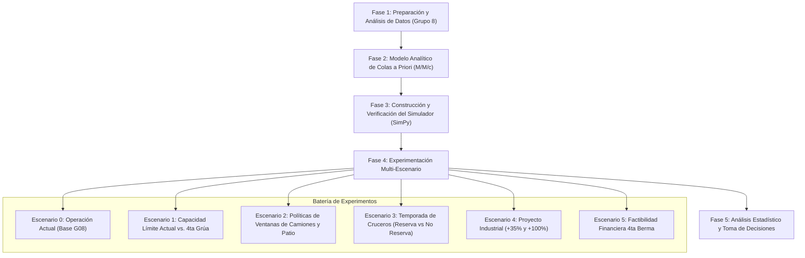
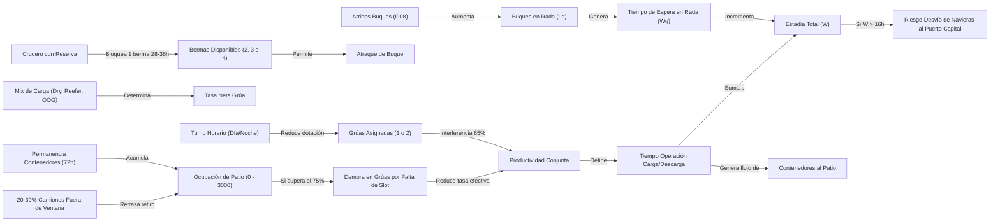
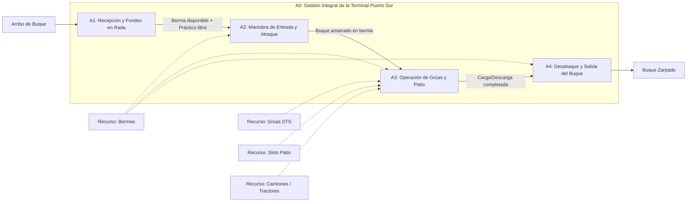
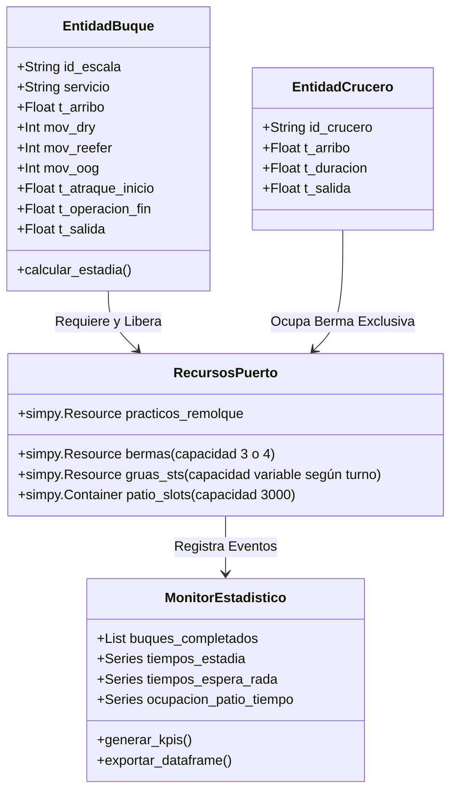

# Trabajo Práctico N° 2 — Investigación Operativa (IO51)
## Modelo Conceptual: Terminal Portuaria "Puerto Sur"
**Cátedra:** 11.51 / IO51 - Investigación Operativa (ITBA) — 2° Cuatrimestre 2026  
**Grupo:** Grupo 08  
**Caso de Estudio:** Puerto Sur — Simulación de Eventos Discretos  
**Conjunto de Datos:** `PuertoSur_escalas_G08.csv` (8.852 escalas históricas registradas)

---

## 1. Objetivo

### 1.1. Objetivo General
Diseñar, formalizar y estructurar un **modelo conceptual de simulación de eventos discretos** que represente fielmente la dinámica operativa, logística y económica de la Terminal Portuaria Puerto Sur, con el fin de evaluar cuantitativamente la capacidad del sistema para satisfacer el umbral de servicio exigido por las navieras regulares (estadía promedio $\le 16$ horas), diagnosticar cuellos de botella en muelle y patio, y sustentar la toma de decisiones estratégicas de inversión y expansión de capacidad.

### 1.2. Objetivos Específicos
1. **Evaluar el estado operativo actual:** Cuantificar los tiempos promedio de espera en rada ($W_q$), tiempo de ocupación de berma ($W_s$) y tiempo de estadía total ($W = W_q + W_s$), verificando el cumplimiento del límite de 16 horas para los tres servicios regulares (*Austral Feeder*, *Andes Container Line*, *TransPatagonia Line*).
2. **Contrastar contra estimaciones analíticas a priori:** Formular y comparar los resultados de la simulación contra un modelo de teoría de colas (líneas de espera con servidores en paralelo $M/M/c$ o $M/G/c$) para validar la coherencia conceptual.
3. **Analizar la adición de una 4ª grúa pórtico STS:** Determinar la demanda diaria máxima soportable bajo la flota actual (3 grúas) vs. la adición de una cuarta grúa pórtico para sostener el nivel de servicio exigido.
4. **Evaluar la política de gestión de patio y camiones:** Simular el impacto de la puntualidad de camiones externos (20%–30% fuera de ventana) sobre la ocupación del patio (3.000 slots) y el bloqueo de grúas cuando la ocupación supera el umbral crítico del 75%, analizando políticas de ampliación de ventana, penalización y reserva de slots diferenciados (reefer vs. dry).
5. **Estudiar la incorporación de la temporada de cruceros:** Medir el impacto de recibir 2 escalas semanales durante 3 meses con ocupación de 28 a 36 h por crucero, evaluando el costo de oportunidad de reservar una berma exclusiva frente a la actividad de carga y determinando el canon de compensación mínimo necesario (respecto a los USD 60.000 ofrecidos).
6. **Tomar decisiones bajo incertidumbre frente al proyecto industrial:** Modelar los escenarios de crecimiento (+35% base y duplicación optimista) mediante criterios clásicos de decisión (Wald / Maximin, Hurwicz, Savage / Minimax Regret, Laplace) y evaluar la conveniencia financiera de invertir en una 4ª berma (USD 12 millones) mediante análisis de repago y costo de inmovilización evitado (USD 15.000 a USD 30.000/día).

---

## 2. Variables de Decisión y de Referencia

Para estructurar formalmente el modelo matemático y computacional, las variables del sistema se clasifican rigurosamente según su rol:

### 2.1. Variables de Decisión (Controlables por el Puerto)
Son los parámetros de control que la dirección y gerencia de operaciones pueden modificar:
* $B$: Número de bermas asignadas al servicio de carga regular ($B \in \{2, 3, 4\}$).
  * $B = 3$: Configuración actual.
  * $B = 2$: Cuando se reserva 1 berma de manera exclusiva para la temporada de cruceros.
  * $B = 4$: Si se aprueba la inversión en la 4ª berma.
* $G$: Flota de grúas pórtico STS disponibles en el muelle ($G \in \{3, 4\}$).
* $\Pi_{gruas}$: Política de asignación y despacho de grúas a buques en berma:
  * Asignación máxima de hasta 2 grúas por buque si hay disponibilidad.
  * Regla de reasignación dinámica al finalizar la atención de un buque adyacente.
* $\Pi_{nocturna}$: Régimen de alistamiento de la 2ª grúa en turno nocturno (activar standby con demora de 15–20 min vs. mantenerla precalentada/operativa continua).
* $\Pi_{camiones}$: Política de gestión de camiones externos y patio:
  * Extensión o rigidez de la ventana horaria de retiro de contenedores.
  * Aplicación de penalidades económicas por arribo fuera de ventana.
* $S_{reefer}$: Política de zonificación del patio: reserva de slots exclusivos para reefer vs. asignación unificada/abierta de los 3.000 slots.
* $Dec_{crucero} \in \{\text{Rechazar}, \text{Aceptar sin reserva exclusiva}, \text{Aceptar con reserva exclusiva}\}$.
* $Dec_{berma4} \in \{\text{Invertir en 4ª berma}, \text{No invertir}\}$.

### 2.2. Variables de Referencia y Exógenas (No Controlables / Estocásticas)
Parámetros del entorno operacional que provienen de la demanda y las condiciones físicas:
* $t_{arribo, i}$: Tiempo de llegada del buque $i$ a la rada (obtenido del registro histórico `PuertoSur_escalas_G08.csv`).
* $\Delta t_i = t_{arribo, i} - t_{arribo, i-1}$: Tiempo entre arribos sucesivos (variable aleatoria con estacionalidad mensual y variación por hora del día).
* $S_i$: Tipo de servicio del buque $i$ ($S_i \in \{\text{Austral Feeder}, \text{Andes Container Line}, \text{TransPatagonia Line}\}$).
* $M_{dry, i}, M_{reefer, i}, M_{oog, i}$: Cantidad de movimientos de contenedores estándar, refrigerados y out of gauge demandados por el buque $i$.
* $T_{maniobra\_in, i}, T_{maniobra\_out, i}$: Tiempo de practicaje y remolque para atraque y desatraque ($T_{maniobra} \sim U(1.0, 2.0)$ horas).
* $\mu_{dry}, \mu_{reefer}, \mu_{oog}$: Tasas nominales de transferencia de una grúa pórtico individual:
  * $\mu_{dry} = 28$ movimientos/hora.
  * $\mu_{reefer} = 28 \times (1 - 0.25) = 21$ movimientos/hora.
  * $\mu_{oog} = 12$ movimientos/hora.
* $\eta_{interf}$: Factor de interferencia operativa cuando 2 grúas trabajan simultáneamente en el mismo buque ($\eta_{interf} = 0.85$ de la suma de productividades).
* $T_{cambio\_turno}$: Demora no operativa por cambio de guardia ($T_{cambio\_turno} \sim U(10, 15)$ minutos cada 8 horas: a las 08:00, 16:00 y 00:00).
* $G_{disponibles}(t)$: Grúas activables según el turno de operación:
  * Diurno (08:00–16:00): 3 grúas activas.
  * Vespertino (16:00–24:00): 3 grúas activas.
  * Nocturno (00:00–08:00): 1 grúa activa + 1 en standby (alistamiento $T_{alist} \sim U(15, 20)$ min) + 1 no disponible.
* $Cap_{patio}$: Capacidad estática máxima del patio (3.000 slots).
* $T_{dwell}$: Tiempo de permanencia promedio de un contenedor en patio ($\mu = 72$ horas).
* $P_{camion\_tardio}$: Probabilidad de que un camión arribe fuera de su ventana horaria ($20\% \le P \le 30\%$).
* $T_{crucero}$: Duración de estadía de un crucero ($T_{crucero} \sim U(28, 36)$ horas, 2 escalas/semana en temporada alta de 3 meses, arribo matutino $\pm 3$ horas).
* Costos financieros:
  * Costo de inmovilización de buque: $C_{inmov} \in [15.000, 30.000]$ USD/día.
  * Ingreso por escala de crucero: $I_{crucero} = 60.000$ USD/escala.
  * Inversión de 4ª berma: $Inv_{berma} = 12.000.000$ USD (vida útil 20 años).

### 2.3. Variables de Salida / Desempeño (KPIs del Negocio)
* $W$: Tiempo medio de estadía del buque en el sistema (fondeo + maniobra + operación + desatraque). **Umbral contractual: $W \le 16$ horas**.
* $W_q$: Tiempo medio de espera en rada (fondeadero) antes de acceder a una berma libre.
* $W_s$: Tiempo medio de permanencia efectiva en berma ($W_s = T_{atraque} + T_{operacion} + T_{desatraque}$).
* $\% Espera$: Proporción del tiempo total consumido en espera inútil: $\frac{W_q}{W} \times 100\%$.
* $L$: Cantidad promedio de buques simultáneos en el puerto (rada + bermas).
* $L_q$: Cantidad promedio de buques en cola en rada.
* $NS_{16}$: Nivel de servicio portuario: porcentaje de buques atendidos con estadía $\le 16$ horas ($P(W \le 16)$).
* $U_{bermas}$: Factor de utilización promedio de las bermas ($\rho_B$).
* $U_{gruas}$: Factor de utilización de las grúas pórtico ($\rho_G$).
* $O_{patio}(t)$: Curva de ocupación instantánea de slots en el patio.
* $P_{cuello\_patio}$: Porcentaje de tiempo que el patio supera el 75% de ocupación ($> 2.250$ slots ocupados) y reduce la tasa efectiva de descarga de las grúas.
* $VAN$, $Payback$: Métricas de rentabilidad financiera del proyecto de ampliación de infraestructura.

---

## 3. Plan de Análisis y Visualización de Resultados

El plan de trabajo experimental se estructura en fases secuenciales de simulación, verificación y toma de decisiones:



### 3.1. Plan de Pruebas Estadísticas y Validación
* **Condición de régimen permanente:** Detección y eliminación del período de calentamiento (*warm-up period*) mediante el método de Welch sobre el tiempo de estadía y la ocupación de patio.
* **Réplicas independientes:** Ejecución de al menos 30 réplicas independientes por configuración con semillas aleatorias diferenciadas para obtener intervalos de confianza robustos del 95% ($t$-Student).
* **Contraste de alternativas:** 
  * Test de ANOVA multifactorial para evaluar significancia de factores (grúas, cruceros, ventanas).
  * Comparación múltiple de medias mediante **Test de Tukey HSD** ($\alpha = 0.05$) para identificar qué políticas difieren significativamente en tiempo de estadía.
  * Análisis de intervalos de confianza pareados para comparar la operación actual vs. 4ª grúa.

### 3.2. Plan de Visualización Gráfica
1. **Histogramas y Densidades Kernel (KDE):** Distribución de tiempos de estadía frente a la línea de corte de 16 horas.
2. **Gráficos de dispersión y series temporales:** Ocupación de patio a lo largo del tiempo, con línea horizontal de alerta en el 75% de ocupación.
3. **Diagramas de Cajas (Boxplots):** Comparativa del tiempo de estadía $W$ y tiempo de espera $W_q$ bajo los diferentes escenarios.
4. **Curvas de Nivel de Servicio:** Gráfico de $P(W \le 16\text{ h})$ en función de la tasa de demanda diaria de buques.
5. **Diagramas de Barras Apiladas:** Descomposición de la estadía por componentes (Espera en Rada, Maniobra de Entrada, Operación de Carga/Descarga, Desatraque).

---

## 4. Relación entre Variables (Diagrama Causal de Influencias)

El sistema portuario se caracteriza por un fuerte acoplamiento entre sus subsistemas (rada, muelle y patio). Las interacciones críticas son:



### Mecanismos Clave de Realimentación y Fricción Operativa:
1. **Efecto cuello de botella del patio:** Cuando la ocupación del patio supera los 2.250 slots ($>75\%$), las grúas STS no pueden descargar a régimen pleno porque deben aguardar que los tractores ubiquen o liberen un slot. Esto alarga la ocupación de la berma, lo que a su vez incrementa la cola en rada ($L_q$), disparando la estadía promedio más allá de las 16 horas.
2. **Efecto interferencia de grúas:** Trabajar con 2 grúas simultáneas sobre un buque acelera la operación, pero rinde solo el 85% de la suma de sus tasas nominales, requiriendo un balance óptimo entre servir más rápido a un buque o asignar grúas a buques concurrentes.
3. **Efecto turnos de dotación:** Durante la noche (00:00 a 08:00) la capacidad de grúas se reduce drásticamente (1 grúa activa + 1 en standby con 15–20 min de alistamiento), generando una desaceleración nocturna de la tasa de atención que genera picos matutinos de congestión.

---

## 5. Diagrama IDEF0

### 5.1. Nivel Superior: Diagrama A-0 (Contexto General)

```
                              [C1: Contratos Navieras (Umbral 16h)]
                              [C2: Capacidad Máxima de Patio (3.000 slots)]
                              [C3: Régimen de Turnos y Paradas (10-15 min cambio)]
                              [C4: Ventanas de Camiones y Prioridades de Reserva]
                                               │
                                               ▼
     [I1: Buques feeder en rada]  ┌────────────────────────────────────────┐  [O1: Buques despachados]
     [I2: Carga Dry/Reefer/OOG]  │                                        │  [O2: Métricas de estadía (W, Wq, Ws)]
 ────[I3: Camiones de retiro]────►│     A-0: OPERAR TERMINAL PORTUARIA     ├─►[O3: Tasa de cumplimiento (<16h)]
     [I4: Escalas de cruceros]   │              PUERTO SUR                │  [O4: Utilización de grúas y bermas]
                                 └────────────────────────────────────────┘  [O5: Ingresos y costos de inmovilización]
                                               ▲
                                               │
                             [M1: 3 Bermas de atraque (o 4)]
                             [M2: 3 Grúas STS pórtico (o 4)]
                             [M3: Tractoristas y slots de patio]
                             [M4: Prácticos, remolcadores y simulador]
```

### 5.2. Descomposición de Primer Nivel: Diagrama A0



* **A1: Recepción y Fondeo en Rada:** Los buques arriban con distribución estocástica según los datos del Grupo 8. Si no hay berma libre (o si está reservada para crucero), esperan fondeados en rada acumulando tiempo $W_q$.
* **A2: Maniobra de Entrada y Atraque:** Asignación de práctico y remolcador. Insume entre 1 y 2 horas. Durante este lapso la berma queda ocupada, pero las grúas no pueden operar.
* **A3: Operación de Carga/Descarga y Patio:** Asignación de hasta 2 grúas STS. Las grúas operan a tasas específicas según el tipo de carga (dry, reefer, OOG), afectadas por cambios de turno, dotación nocturna e interferencia mutua. Los contenedores descargados ingresan a los 3.000 slots del patio, de donde son retirados por camiones externos.
* **A4: Desatraque y Salida:** Maniobra de desamarre y salida a mar abierto con práctico y remolcador (1 a 2 horas). Se libera la berma para el próximo buque en cola.

---

## 6. Lógicas del Sistema

### 6.1. Lógica de Arribo y Asignación de Berma
1. El buque regular arriba a las coordenadas de rada en el instante $t_{arr}$.
2. Si el número de buques atracados es menor a las bermas disponibles para carga ($N_{atracados} < B_{disp}$):
   * Si una berma está reservada para un crucero inminente (ventana de arribo matutino $\pm 3$ h), dicha berma no se asigna al buque regular.
   * Si hay berma disponible: el buque solicita el servicio de practicaje y remolque para ingresar.
3. Si todas las bermas están ocupadas, el buque entra a la cola de fondeo en rada (disciplina FIFO).

### 6.2. Lógica de Maniobras de Atraque y Desatraque
* **Atraque:** Toma $T_{man\_in} \sim U(1.0, 2.0)$ horas. La berma pasa a estado ocupada, pero las grúas STS no intervienen.
* **Desatraque:** Al concluir la totalidad de los movimientos de carga y descarga, se solicita práctico y remolcador durante $T_{man\_out} \sim U(1.0, 2.0)$ horas. Al finalizar, la berma queda formalmente libre y disponible.

### 6.3. Lógica de Productividad y Asignación de Grúas
1. Al quedar amarrado el buque, el planificador de muelle asigna hasta 2 grúas disponibles de la flota.
2. La carga del buque se descompone en $M_{dry}$, $M_{reefer}$ y $M_{oog}$.
3. Cada grúa opera con tiempos de servicio estocásticos o productividades horarias netas:
   $$\text{Tasa Base}(m) = \begin{cases} 28 \text{ mov/h} & \text{si es Dry} \\ 21 \text{ mov/h} & \text{si es Reefer} \\ 12 \text{ mov/h} & \text{si es OOG} \end{cases}$$
4. Si se asignan 2 grúas al buque, la tasa combinada es:
   $$\text{Tasa Dual} = 0.85 \times \left( \text{Tasa Grúa 1} + \text{Tasa Grúa 2} \right)$$
5. **Afectación de turnos:**
   * Diurno (08:00–16:00) y Vespertino (16:00–24:00): hasta 3 grúas operativas en simultáneo en el muelle.
   * Nocturno (00:00–08:00): 1 grúa activa. Si se requiere una segunda grúa, debe incurrirse en un tiempo de alistamiento $T_{alist} \sim U(15, 20)$ minutos antes de comenzar a operar.
   * En cada cambio de guardia (00:00, 08:00, 16:00), se suspende la operación durante $T_{cambio} \sim U(10, 15)$ minutos.
6. **Afectación de patio:** Si en cualquier momento la ocupación de slots supera los 2.250 contenedores ($>75\%$), la tasa efectiva de descarga de las grúas se reduce proporcionalmente a la tasa de disponibilidad de slots liberados por los camiones.

### 6.4. Lógica de Patio y Camiones Externos
1. Cada movimiento de descarga genera un contenedor que ingresa a un slot del patio.
2. Cada contenedor permanece en el patio un tiempo $T_{dwell}$ con media de 72 horas.
3. Se modela el flujo de camiones externos asignados con ventanas horarias:
   * El $70\% - 80\%$ llega dentro de su franja horaria designada.
   * El $20\% - 30\%$ llega tarde (fuera de ventana), lo que congestiona la playa de camiones y retrasa el retiro del contenedor, reteniendo el slot ocupado.

### 6.5. Lógica de Cruceros
1. Durante los 3 meses de temporada alta de fruta, arriban 2 cruceros semanales.
2. Su arribo tiene una dispersión de $\pm 3$ horas respecto al horario matutino estipulado.
3. Ocupan una berma durante $T_{crucero} \sim U(28, 36)$ horas continuas.
4. No utilizan grúas pórtico STS (utilizan grúas propias).
5. Si rige la política de **reserva exclusiva**, la berma asignada debe mantenerse vacía y reservada con antelación suficiente a su ventana de llegada, impidiendo el atraque de buques de carga que pudieran bloquearla.

---

## 7. Elementos del Simulador (Arquitectura SimPy)

El simulador se implementará en Python con el framework de simulación de eventos discretos **SimPy**. La arquitectura técnica de objetos y procesos se define como:



### 7.1. Entidades (Processes en SimPy)
* `proceso_buque(env, buque_data, recursos, monitor)`: Modela el ciclo de vida completo de cada buque feeder desde su llegada a rada hasta su desatraque y salida a mar abierto.
* `proceso_crucero(env, crucero_data, recursos, monitor)`: Modela la ocupación periódica y prolongada de berma durante la temporada estival.
* `proceso_gestion_turnos(env, recursos)`: Proceso de fondo que conmuta la disponibilidad de grúas cada 8 horas (3 grúas diurno/vespertino $\leftrightarrow$ 1+1 nocturno) y pausa la operación durante los 10–15 minutos de cambio de turno.
* `proceso_retiro_camiones(env, recursos)`: Proceso estocástico que extrae contenedores del patio representando el flujo de camiones externos y su impuntualidad.

### 7.2. Recursos del Entorno (`simpy.Environment`)
* `recurso_bermas`: `simpy.Resource(env, capacity=3)` (o `capacity=4` para evaluar la 4ª berma).
* `recurso_gruas`: `simpy.PriorityResource(env, capacity=3)` gestionado dinámicamente según el turno.
* `contenedor_patio`: `simpy.Container(env, capacity=3000, init=ocupacion_inicial)` para trackear nivel de llenado.

### 7.3. Monitor Estadístico y Variables de Estado
* Registro individual por escala de: `t_arribo`, `t_berma_asignada`, `t_inicio_operacion`, `t_fin_operacion`, `t_zarpada`.
* Cálculo vectorizado de $W_q = t_{berma\_asignada} - t_{arribo}$, $W_s = t_{zarpada} - t_{berma\_asignada}$ y $W = t_{zarpada} - t_{arribo}$.
* Registro continuo de utilización instantánea de bermas, grúas y slots de patio para curvas de nivel y gráficos temporales.
