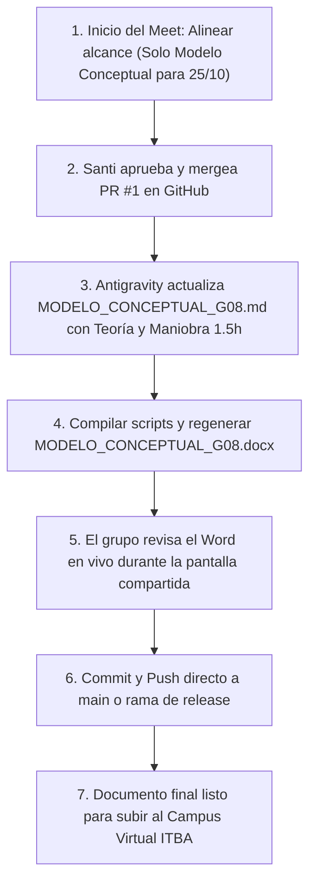

# Plan Integral de Revisión: Modelo Conceptual (Entrega 25/10), Aprobaciones de Santi y Alineación Teórica

> **Cátedra:** 11.51 / IO51 - Investigación Operativa — ITBA 2026 2° Cuatrimestre  
> **Grupo:** Grupo 08 — Terminal Portuaria "Puerto Sur"  
> **Fecha de Elaboración:** Sábado 24 de Octubre de 2026  
> **Hito Próximo:** Entrega 1 — Modelo Conceptual del Sistema (Domingo 25/10/2026 23:59)

---

## Goal Description
Estructurar la reunión de equipo (meet) de hoy sábado 24/10 para auditar, corregir y consolidar formalmente el **Modelo Conceptual de la Terminal Portuaria Puerto Sur**, asegurando:
1. **Concordancia estricta al 100% con la teoría oficial de la cátedra** expuesta en las tres presentaciones cargadas en `assets/`:
   - `IO51_Teoria_Modelo_Conceptual_Simulacion.pdf`
   - `IO51_Teoria_Simulacion_Discreta_Diagramas_Procesos_Logicos.pdf`
   - `IO51_Teoria_Simulacion_Modelo_de_Datos_Ajuste.pdf`
2. **Gobernanza clara de aprobaciones para Santi (`santim1897`) y el grupo**, destrabando los 3 Pull Requests abiertos y definiendo la sincronización limpia de Git.
3. **Generación del entregable institucional definitivo (`MODELO_CONCEPTUAL_G08.docx`)**, libre de rutas absolutas rotas (`C:/Users/ASUS/...`) y con las correcciones operativas necesarias (maniobras náuticas de 1 a 2 horas conjuntas).

---

## User Review Required

> [!IMPORTANT]
> **Alcance estricto de la entrega de mañana (25/10):** Se entrega **únicamente el documento del Modelo Conceptual**. No se entrega código de simulación terminado ni corridas definitivas de los escenarios c, d, e, f, g.

> [!WARNING]
> **Estado de Git para el meet:** Las reglas del proyecto (`AGENTS.md`) y el backlog (`docs/BACKLOG_AUDITORIA.md`) están commiteadas y pusheadas en la rama `feat/project-rules-setup` (PR #1), pero **aún no están en `main`**. En la página principal de GitHub nadie las ve a menos que entren a Pull Requests. El PR #1 está limpio (`MERGEABLE`) y debe mergearse durante la reunión.

> [!CAUTION]
> **Rutas absolutas en documentos de Santi:** En el commit `ee75046` pusheado por Santi a `main`, las imágenes y scripts contienen rutas fijas como `file:///C:/Users/ASUS/...`. Esto rompe la visualización de diagramas para cualquier otro usuario o docente que clone el repositorio. Se debe estandarizar a rutas relativas (`plots/...`).

---

## Open Questions

1. **¿Quién realiza el merge del PR #1 en GitHub?**  
   Cualquier miembro del equipo con permisos de escritura puede presionar *Merge Pull Request* en GitHub. Recomendamos que Santi lo revise y apruebe en vivo durante la reunión.
2. **¿Quién sube el Word final al Campus del ITBA?**  
   Designar al responsable de subir `MODELO_CONCEPTUAL_G08.docx` al buzón antes de la medianoche del domingo 25/10.

---

# PARTE 1: Plan de Revisión Técnica y Auditoría contra la Teoría (`assets/`)

Este bloque establece la lista de verificación exhaustiva punto por punto comparando el trabajo existente contra las tres presentaciones teóricas de la cátedra:

```
                            MATRIZ DE TRAZABILIDAD TEÓRICA (IO51)
 ┌─────────────────────────────────────────────────────────┬───────────────────────────────────────────┐
 │ Requisito Teórico Cátedra (Diaps assets/)               │ Estado Actual en MODELO_CONCEPTUAL_G08    │
 ├─────────────────────────────────────────────────────────┼───────────────────────────────────────────┤
 │ 1. Objetivo (+ Alcance y Supuestos: ¿Qué, Dónde, etc?)  │ Parcial: Excelente objetivo; falta 1.3    │
 │ 2. Variables de Decisión vs. Referencia vs. Estado      │ Sólido: Clasificación completa y clara    │
 │ 3. Plan de Análisis y Plan de Cuadros (Tablas con IC)   │ Parcial: Hay DOE; falta tabla de cuadros  │
 │ 4. Diagramas de Proceso IDEF0 (Contexto A-0 y A0 ICOM)  │ Aprobado: Diagramas a 300 DPI presentes   │
 │ 5. Diagrama de Relación entre Variables (Causal/CLD)    │ Aprobado: Diagrama gráfico y bucles       │
 │ 6. Lógicas Eventuales (Action Charts / Ruteos sin dt)   │ Aprobado: Diagrama de flujo y pseudocódigo│
 │ 7. Elementos del Sistema (Entidades, Recursos, Colas...)│ Aprobado: Mapeo de componentes y SimPy    │
 │ 8. Modelo de Datos Cuantificado (Tabla Diap 19)         │ Pendiente: Incorporar tabla formal        │
 └─────────────────────────────────────────────────────────┴───────────────────────────────────────────┘
```

### 1.1. Auditoría Teórica Detallada

#### A. `IO51_Teoria_Modelo_Conceptual_Simulacion.pdf`
* **Diapositivas 4 y 21 (Objetivo, Alcance y Supuestos):**
  * *Exigencia:* Para definir el problema se deben considerar: ¿Qué? ¿Por qué? ¿Dónde? ¿Cuándo? ¿Quién? ¿Cuánto? y explicitar los supuestos simplificatorios.
  * *Diagnóstico:* `MODELO_CONCEPTUAL_G08.md` define excelentes objetivos de negocio ($W \le 16\text{ h}$) y de simulación, pero carece de un acápite explícito titulado **"1.3. Alcance y Supuestos Simplificatorios"** que responda sistemáticamente a estas preguntas guía.
  * *Acción:* Agregar la sección 1.3 cubriendo horizonte temporal (3 años), límites físicos (muelle y patio), entidades modeladas y supuestos de estiba.
* **Diapositiva 5 (Variables de Decisión y Referencia):**
  * *Exigencia:* Distinguir entre variables de decisión (parámetros modificables para evaluar alternativas) y variables de referencia (outputs de la simulación para toma de decisiones).
  * *Diagnóstico:* Cumplido con excelencia en la Sección 2.
* **Diapositivas 11-13 (Variables de Estado y Evolución de Eventos):**
  * *Exigencia:* Variables que contienen información suficiente para describir el sistema en un instante ($n(t)$ buques, slots ocupados) y distinción de eventos exógenos ($Ex$) vs. endógenos ($En$).
  * *Acción:* Enriquecer la Sección 7.3 formalizando la tabla de eventos exógenos (arribo buque, arribo camión) y endógenos (fin maniobra, fin operación grúa, cambio de turno).
* **Diapositivas 14 y 15 (Plan de Análisis y Plan de Cuadros):**
  * *Exigencia:* "Plan de análisis" = orden y criterio de escenarios a evaluar. "Plan de cuadros" = cómo se mostrarán los resultados (tablas o dashboards con intervalos de confianza de variables de referencia).
  * *Diagnóstico:* La sección 3 lista los factores del DOE, pero le falta la **maqueta tabular formal del Plan de Cuadros** (matriz de escenarios vs. columnas de $W \pm \text{IC}_{95\%}$, $W_q$, nivel de servicio, etc.).
  * *Acción:* Incorporar en la Sección 3.2 la tabla plantilla del Plan de Cuadros requerida por la cátedra.
* **Diapositivas 16, 17 y 21 (Diagramas IDEF0):**
  * *Exigencia:* Convención formal ICOM (Inputs por izquierda, Controls por arriba, Outputs por derecha, Mechanisms por abajo).
  * *Diagnóstico:* Cumplido. Santi generó `fig_idef0_a_menos_0.png` y `fig_idef0_a0_descomposicion.png` a 300 DPI.
* **Diapositiva 20 (Diagrama de Influencias Causal):**
  * *Exigencia:* Relación entre variables aleatorias, atributos y variables de estado.
  * *Diagnóstico:* Cumplido con `fig_relacion_variables_causal.png`.

#### B. `IO51_Teoria_Simulacion_Discreta_Diagramas_Procesos_Logicos.pdf`
* **Diapositiva 8 (Lógicas Complejas / Action Charts):**
  * *Exigencia:* Diagramas para reglas de comportamiento, decisiones condicionadas y ruteos instantáneos (donde no transcurre tiempo simulado).
  * *Diagnóstico:* Cumplido con `fig_logica_flujo_buque.png` y los algoritmos en texto estructurado de la Sección 6.

#### C. `IO51_Teoria_Simulacion_Modelo_de_Datos_Ajuste.pdf`
* **Diapositiva 19 (Tabla del Modelo de Datos):**
  * *Exigencia:* Cuantificación de todo elemento definido en el Modelo Conceptual mediante la tabla estándar:
    $$\text{Variable} \mid \text{Descripción} \mid \text{U.M.} \mid \text{Valor} \mid \text{Relación/Expresión} \mid \text{Característica (Tipo y Parámetros)}$$
  * *Diagnóstico:* Falta incorporar esta tabla sintética que sintetiza los parámetros empíricos extraídos de `PuertoSur_escalas_G08.csv` (tasas de arribo, mix dry/reefer/oog, productividades nominales de grúa).
  * *Acción:* Agregar la tabla en una nueva sección 2.4 o en el anexo de datos cuantificados.

---

### 1.2. Correcciones Críticas al Documento Existente

Las siguientes 3 modificaciones técnicas deben realizarse sobre `MODELO_CONCEPTUAL_G08.md` y el script generador de Word:

#### [MODIFY] `MODELO_CONCEPTUAL_G08.md`
1. **Corrección del Tiempo de Maniobra (Atraque y Desatraque):**
   * *Texto anterior:* Maniobra de entrada $U(1, 2)$ h y desatraque $U(1, 2)$ h (suma total 2 a 4 horas; media 3.0h).
   * *Texto corregido conforme a pauta:* "Insumen en conjunto entre 1 y 2 horas por buque" ($T_{maniobra\_total} \sim U(1.0, 2.0)$ horas, media 1.5h total, desglosado en $T_{atraque} \sim U(0.5, 1.0)$ h y $T_{desatraque} \sim U(0.5, 1.0)$ h).
   * *Lugares a corregir:* Sección 2.3, Sección 5.2 (Actividades A2 y A4) y Sección 6 (Lógicas 2 y 7).
2. **Corrección de Rutas Absolutas a Relativas:**
   * Reemplazar todas las ocurrencias de:
     ``
     por:
     ``
3. **Incorporación de la Sección 1.3 (Alcance y Supuestos):**
   * Añadir las respuestas a ¿Qué?, ¿Por qué?, ¿Dónde?, ¿Cuándo?, ¿Quién?, ¿Cuánto? y los supuestos de grúas, patio y clima.
4. **Incorporación del Plan de Cuadros (Sección 3.2):**
   * Tabla plantilla del diseño de experimentos con columnas de medias e intervalos de confianza al 95%.
5. **Incorporación de la Tabla de Modelo de Datos (Sección 2.4):**
   * Tabla formal según la diapositiva 19 de la teoría.

#### [MODIFY] `src/generate_word_report.py` y `src/generate_conceptual_diagrams.py`
1. Reemplazar la ruta por defecto `output_path="C:/Users/ASUS/..."` por `os.path.join(os.path.dirname(__file__), "..", "MODELO_CONCEPTUAL_G08.docx")`.
2. Actualizar la función `build_conceptual_word_doc()` para reflejar el tiempo de maniobra corregido (1.5h total) y la sección de alcance/supuestos.
3. Ejecutar la compilación para generar el Word definitivo `MODELO_CONCEPTUAL_G08.docx`.

---

# PARTE 2: Plan de Gobernanza, Aprobaciones de Santi y Estrategia de Git

Esta sección define el tablero de control de Pull Requests y la guía para la reunión de hoy:

```
                            TABLERO DE ESTADO DE PULL REQUESTS (GitHub)
 ┌──────┬────────────────────────────────────────────────────────┬─────────┬──────────────┬──────────────────────────────┐
 │ PR # │ Título / Descripción                                   │ Estado  │ Mergeable?   │ Acción Requerida en Meet     │
 ├──────┼────────────────────────────────────────────────────────┼─────────┼──────────────┼──────────────────────────────┤
 │ #1   │ feat: reglas de proyecto, AGENTS.md, .gitignore...     │ OPEN    │ ✅ CLEAN     │ Santi: APROBAR Y MERGEAR     │
 │ #2   │ feat: pasos 1 y 2 (rutas portables y ajuste K-S)       │ OPEN    │ ⚠️ CONFLICT  │ Rebasar sobre main de Santi  │
 │ #3   │ feat: paso 3 (física del simulador SimPy PriorityRes)  │ OPEN    │ ✅ CLEAN     │ Dejar abierto para Fase 2    │
 └──────┴────────────────────────────────────────────────────────┴─────────┴──────────────┴──────────────────────────────┘
```

### 2.1. Lista de Cosas que Santi (`santim1897`) Debe Revisar y Aprobar

| # | Ítem para Revisión de Santi | Estado Actual | Criterio de Aprobación |
| :-: | :--- | :---: | :--- |
| **1** | **Merge de PR #1 (`feat/project-rules-setup`)** | 🟡 Pendiente | Aprobar en GitHub con *Squash and Merge*. Incorpora `AGENTS.md` y `docs/` a `main` sin tocar el código existente. |
| **2** | **Ajuste de Maniobras a 1-2h conjuntas en Modelo Conceptual** | 🟡 Pendiente | Validar que el cambio de $U(1, 2)$ individual a $U(1, 2)$ conjunto respeta la pauta oficial (`IO51-TP2 - Puerto Sur.pdf`). |
| **3** | **Portabilidad de Rutas (`plots/...` vs `C:/Users/ASUS/`)** | 🟡 Pendiente | Confirmar que los scripts corran indistintamente en la PC de Santi (`ASUS`), la de Bautista y cualquier evaluador. |
| **4** | **Revisión del Documento Word Final (`MODELO_CONCEPTUAL_G08.docx`)** | 🟡 Pendiente | Abrir el archivo `.docx`, verificar que los 5 diagramas a 300 DPI se vean nítidos y que la carátula contenga a todos los integrantes. |
| **5** | **Entrega Oficial en Buzón del Campus** | ⚪ Para el 25/10 | Designar quién sube el archivo antes de las 23:59 hs del domingo. |

---

### 2.2. Guía de Ejecución Paso a Paso para la Reunión de Hoy (Meet)



#### Paso 1: Apertura de la reunión y encuadre
* Explicar al grupo que la entrega de mañana es **únicamente conceptual** (documento Word con los 7 puntos de la rúbrica). Nadie debe preocuparse por tener cerradas todas las simulaciones de los escenarios hoy.

#### Paso 2: Aprobación y merge del PR #1 en GitHub
* Santi ingresa a [https://github.com/Santim1897/TP2-IO/pull/1](https://github.com/Santim1897/TP2-IO/pull/1).
* Como el estado es **Clean / Mergeable**, hace clic en **"Merge pull request"** (o *Squash and merge*).
* Con esto, las reglas, el backlog y el diagnóstico quedan formalmente en `main` para que todos los lean en la raíz del repo.

#### Paso 3: Aplicación de las mejoras conceptuales
* Aplicar los cambios en `MODELO_CONCEPTUAL_G08.md`:
  - Corrección de maniobra (1.5h conjunto).
  - Normalización de rutas relativas `plots/`.
  - Inclusión de sección 1.3 (Alcance y Supuestos).
  - Inclusión de maqueta del Plan de Cuadros (Sección 3.2).
  - Inclusión de la tabla de Modelo de Datos (Sección 2.4).

#### Paso 4: Regeneración del Word institucional
* Ejecutar en terminal `python src/generate_word_report.py`.
* Se genera el archivo `MODELO_CONCEPTUAL_G08.docx` actualizado con las figuras en alta resolución y la tabla de metadatos del Grupo 8.

#### Paso 5: Revisión colegiada en pantalla compartida
* Abrir `MODELO_CONCEPTUAL_G08.docx` en Word.
* Revisar los nombres de los integrantes: Bautista Fanelli, Santiago Montiel, Benjamín...
* Chequear la visualización de los 5 diagramas gráficos.

#### Paso 6: Commit y Push
* Commitear los cambios con mensaje institucional:
  `docs: consolidar modelo conceptual con teoria IO51, maniobras 1.5h y exportar word definitivo`
* Pushear a GitHub.

---

## Verification Plan

### Automated Tests
1. **Verificación de rutas e importaciones Python:**
   ```powershell
   python -c "import docx, matplotlib; print('Dependencias OK')"
   ```
2. **Generación automática del documento Word:**
   ```powershell
   python src/generate_word_report.py
   ```
   *Salida esperada:* `MODELO_CONCEPTUAL_G08.docx generado con éxito` y tamaño aproximado de ~1.5 MB.
3. **Verificación de ausencia de rutas fijas:**
   ```powershell
   git grep "Users/ASUS" MODELO_CONCEPTUAL_G08.md
   ```
   *Salida esperada:* Sin resultados (0 matches).

### Manual Verification
1. Abrir `MODELO_CONCEPTUAL_G08.docx` con Microsoft Word.
2. Confirmar que la carátula contiene a todos los integrantes del Grupo 8.
3. Verificar que las 5 figuras (IDEF0 A-0, IDEF0 A0, Causalidad, Flujo Buque y Componentes SimPy) aparecen completas, legibles y nítidas.
4. Constatar que en la sección 5 y 6 el tiempo de maniobra diga expresamente "en conjunto entre 1 y 2 horas".
